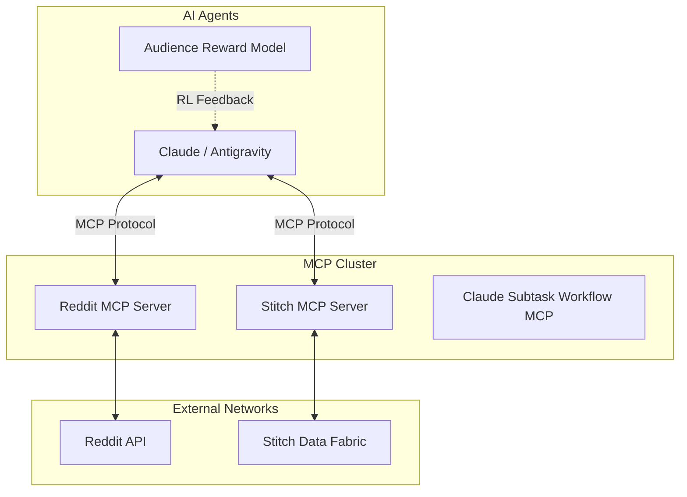

# Social Media Communication Command Center (SMCCC)
## Technical Specification & Implementation Plan

### 1. Executive Summary & Vision
The **Social Media Communication Command Center (SMCCC)** is an advanced operations interface and orchestration engine built on top of the `anse.community` module. It unifies autonomous research dissemination, contextual bandit RL (audience reward modeling), and real-time social media engagement into a single, cohesive command-line and web dashboard. 

Crucially, this iteration replaces legacy direct API clients (like PRAW or manual HTTP scraping) with a standardized **Model Context Protocol (MCP)** architecture. By leveraging the **Reddit MCP Server** and the **Stitchkit/Stitch-MCP** ecosystem, the SMCCC allows AI agents (like Claude and Antigravity) to natively read, write, and moderate social media streams without brittle API abstractions.

### 2. Core Objectives
1.  **Unified Social Media Orchestration:** Provide a central hub for agents to schedule posts, monitor karma metrics, and respond to community feedback.
2.  **Reddit MCP Integration:** Use the Reddit MCP to directly fetch subreddits, read post histories (e.g. `callensxavier@gmail.com` / `OrganizationTop9026`), and reply to threads.
3.  **Stitch/Stitchkit Integration:** Incorporate Google's Stitch MCP server (via `https://stitch.googleapis.com/mcp`) for unified, cross-platform social media capabilities and data fabric unification.
4.  **Reputation Management:** Actively monitor and mitigate negative comment karma blocks (e.g., the current -7 comment karma preventing posts on `r/ClaudeAI` and `r/singularity`) by autonomously seeking high-value, friendly threads for positive engagement.
5.  **Viral Content Amplification:** Leverage the OpenAI vs. Claude AI rivalry hype to promote the recent epistemic audit of OpenAI's Navier-Stokes formal proof.

---

### 3. Architecture & Components

### 4. Implementation Steps

#### Phase 1: Infrastructure and MCP Tooling (COMPLETED)
- [x] Clone `https://github.com/tygwan/stitchkit` and `https://github.com/piyushcreates/stitch-mcp` into `third_party/`.
- [x] Register `stitch` MCP server in `.mcp.json` and `mcp_config.json` using the provided `X-Goog-Api-Key`.

#### Phase 2: Reddit MCP Integration
- [ ] Configure the Reddit MCP server in `.mcp.json` (either via a generic HTTP MCP or a specialized Reddit MCP client).
- [ ] Implement `fetch_user_karma` and `post_reply` tools through the MCP interface to replace legacy PRAW calls in `anse/community/reddit_trend_scout.py`.

#### Phase 3: Reputation Repair Protocol
- **Objective:** Recover `OrganizationTop9026` from -7 comment karma to > +15 comment karma to unlock `r/ClaudeAI` and `r/singularity`.
- **Strategy:** 
  1. Use Reddit MCP to scan target "friendly" communities (e.g., `r/FluidMechanics`, where the user had a successful post, or generic tech support subs open to users with 5 years account age).
  2. Autonomously draft high-quality, helpful, non-controversial comments to users asking for help.
  3. Engage in the comments section of the user's *own* successful Navier-Stokes posts to farm safe comment karma.

#### Phase 4: The Navier-Stokes Dissemination Campaign
- **Context:** The user audited OpenAI's Lean 4 Navier-Stokes proof using Claude Code and the deterministic sandbox.
- **Hook:** "Did OpenAI solve the wrong Navier-Stokes problem?" - leverage the Scientific American article and Reddit discussions.
- **Target Audience:** `r/LocalLLM`, `r/MachineLearning`, `r/math`.
- **Execution via Stitch/Reddit MCP:** The Command Center will format the DPO-optimized posts and schedule them across multiple platforms using Stitch, simultaneously listening to comments via the Reddit MCP to defend the work using `cognitive_shield.py`.

### 5. Stitchkit & Stitch-MCP Details
Stitchkit enables the command center to weave together disparate API payloads and user profiles. The `stitch` MCP exposes the Stitch data fabric directly to the agent.
*   **Path:** `third_party/stitchkit`, `third_party/stitch-mcp`.
*   **Capabilities:** Multi-channel broadcast, unified identity mapping (mapping `callensxavier@gmail.com` to `OrganizationTop9026`), and automated social sentiment analytics.

### 6. Next Steps for Development
1. Write the Python CLI entry point (`scripts/social_command_center.py`) that initializes the MCP clients using `mcp.client`.
2. Connect the `ContextualBandit` (`anse/community/contextual_bandit.py`) to the Stitch stream to real-time update weights based on upvote velocity.
